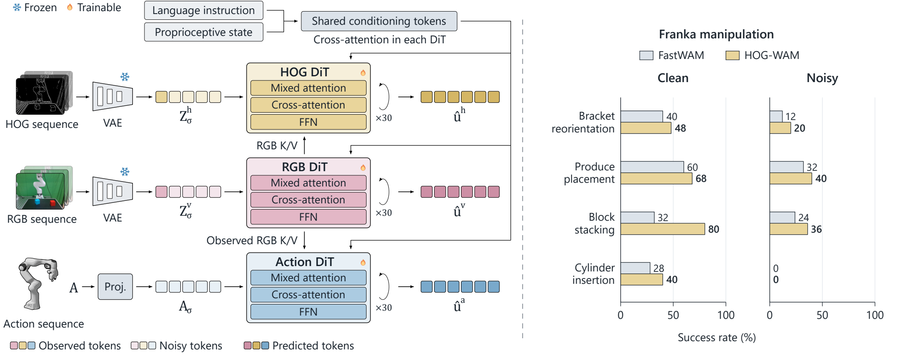

# HOG-WAM: Improving Visual Robustness through Future Gradient Prediction

Boxuan Dong<sup>1</sup>, Yupeng Qian<sup>1</sup>, Ying Wu<sup>1</sup>, Heshuai Li<sup>1</sup>, Junhao Tan<sup>1</sup>, Zhenxiong Tan<sup>2</sup>, Weijia Wu<sup>2,&#42;</sup>, and Weihao Yu<sup>1,&#42;</sup>

<sup>1</sup> Peking University · <sup>2</sup> National University of Singapore<br>
<sup>&#42;</sup> Corresponding authors

[Paper: arXiv:2611.34811](https://arxiv.org/abs/2611.34811)

HOG-WAM adds future Histogram of Oriented Gradients (HOG) prediction to the joint RGB and action training objective of FastWAM. During training, an auxiliary HOG DiT learns from structural targets derived from demonstration frames. At inference, the exported policy uses only the RGB and action DiT modules; it does not compute HOG.



*From the preprint: the training architecture (left) and success rates on four Franka tasks (right).*

This code is based on [FastWAM-JAX](https://github.com/iPPLab/FastWAM-JAX) ([upstream revision](https://github.com/iPPLab/FastWAM-JAX/tree/54e1ad264eedae85472edda3ddd159557fc46a00)). It extends the upstream JAX/Flax implementation with HOG supervision, the RoboTwin-Plus corruption protocol, and LIBERO training and LIBERO Plus evaluation.

[Install](#installation) · [Prepare data](#prepare-training-inputs) · [Train](#training) · [RoboTwin](#robotwin-20-and-robotwin-plus) · [LIBERO Plus](#libero-plus) · [Verify](#verification)

## Installation

Run the commands from the repository root on Linux with Git, Bash, Python 3.12, and [uv](https://docs.astral.sh/uv/getting-started/installation/). Use an NVIDIA GPU with the JAX CUDA 12 runtime for local training and inference. RoboTwin and LIBERO Plus run in separate Python environments so their simulator dependencies do not override JAX dependencies.

~~~bash
git clone https://github.com/iPPLab/HOG-WAM.git
cd HOG-WAM
uv sync --locked --python 3.12 --group dev --extra cuda
uv tool install huggingface-hub
~~~

To train from initialization, start with [Prepare training inputs](#prepare-training-inputs). If you already have a compatible BF16 policy export, go directly to the relevant evaluation section and prepare the assets it lists. The repository does not bundle trained policy checkpoints, datasets, or simulator assets.

## Prepare training inputs

### Wan2.2 initialization

Download the video DiT and VAE from the [Wan2.2-TI2V-5B Orbax release](https://huggingface.co/ipplab/Wan2.2-TI2V-5B-Orbax). The VAE remains frozen during training. The trainable RGB DiT starts from the video weights; HOG-WAM initializes its trainable HOG DiT from the same weights. Build the ActionDiT initialization once for both benchmarks.

~~~bash
WAN_REPO=ipplab/Wan2.2-TI2V-5B-Orbax
WAN_REV=c83dfe62ff6432dbc6090ade7d3b38ac05733118

hf download "$WAN_REPO" --revision "$WAN_REV" \
  --include 'video_dit/**' 'vae/**' --local-dir checkpoints/wan
uv run --locked python tools/convert_weights.py build-action-init \
  checkpoints/wan/video_dit checkpoints/wan/action_init \
  --config configs/training/robotwin-baseline.example.yaml
~~~

### RoboTwin 2.0

Use the [FastWAM RoboTwin 2.0 release](https://huggingface.co/datasets/yuanty/robotwin2.0-fastwam), which contains 27,500 demonstrations: 50 clean and 500 randomized demonstrations for each of 50 tasks. Keep the released normalization statistics. Both recipes use a trajectory-level split of 27,225 training and 275 validation demonstrations.

~~~bash
DATASET=yuanty/robotwin2.0-fastwam
DATA_REV=aac262c35d02cc71b2f6ef670bd65fd9f2bb2547

hf download "$DATASET" dataset_stats.json --repo-type dataset \
  --revision "$DATA_REV" --local-dir data/robotwin
hf download "$DATASET" --repo-type dataset --revision "$DATA_REV" \
  --include 'robotwin2.0.tar.gz.part-*' --local-dir data/robotwin
cat data/robotwin/robotwin2.0.tar.gz.part-* | tar -xzf - -C data/robotwin

uv run --locked --extra dataset python tools/prepare_robotwin.py \
  --source data/robotwin/robotwin2.0 --output data/robotwin/twp
uv run --locked python tools/prepare_robotwin_text.py collect \
  --l3 data/robotwin/twp --out data/robotwin/text
uv run --locked --extra convert python tools/prepare_robotwin_text.py encode \
  --dir data/robotwin/text --device cuda --dtype float32
~~~

The packer writes aligned TWP3 episodes containing head, left-wrist, and right-wrist RGB; 14-dimensional joint state and actions; and the episode instruction. This recipe repacks the public release rather than reusing the original packed trajectories. It does not apply the channel swap or action shift of the legacy packing profile. The text side table and evaluation service use the same UMT5 encoder and prompt template.

### LIBERO

Use all 2,000 demonstrations from the four standard suites: Spatial, Object, Goal, and LIBERO-10. The download script pins the dataset revision. Preparation writes the trajectory index, min/max normalization statistics, and UMT5 embeddings for the training instructions.

~~~bash
uv run --locked --extra convert python tools/download_libero.py --root data/libero/raw
uv run --locked --extra libero python tools/prepare_libero.py --root data/libero/raw
uv run --locked --extra convert python tools/prepare_libero.py \
  --root data/libero/raw --encode-text data/libero/text_cache --device cuda
~~~

LIBERO uses the agent-view and wrist RGB cameras, eight-dimensional end-effector and gripper state, and seven-dimensional OSC-POSE actions. Keep its own normalization statistics for both training and evaluation.

## Training

| Benchmark | Recipes in `configs/training/` | Effective batch | Optimizer steps |
| --- | --- | ---: | ---: |
| RoboTwin 2.0 | `robotwin-baseline.example.yaml`, `robotwin-hog.example.yaml` | 1,024 | 29,365 |
| LIBERO | `libero-baseline.example.yaml`, `libero-hog.example.yaml` | 256 | 13,200 |
| LIBERO RGB-to-HOG ablation | `libero-rgb-to-hog.example.yaml` | 256 | 13,200 |

All recipes use eight independently noised action copies, a peak learning rate of `1e-4`, and weight decay of `1e-2`. The baseline trains RGB and action prediction. HOG-WAM adds a unit-weight future-HOG objective. RGB-to-HOG instead replaces RGB with HOG before VAE encoding and retains that input transform at inference.

### Local GPU

The paths in the example recipes match the downloads above. For a different layout, copy the desired recipe under `configs/training/` and edit the paths in the copy. Match `tpu.accelerator: gpu-N` to the number of visible GPUs. The microbatch must be a multiple of that count and divide the effective batch. Give each model a distinct run name:

~~~bash
JAX_PLATFORMS=cuda,cpu uv run --locked --extra cuda python -m fastwam_tpu.training.train \
  configs/training/robotwin-baseline.example.yaml tpu.run_name=robotwin-baseline
JAX_PLATFORMS=cuda,cpu uv run --locked --extra cuda python -m fastwam_tpu.training.train \
  configs/training/robotwin-hog.example.yaml tpu.run_name=robotwin-hog

JAX_PLATFORMS=cuda,cpu uv run --locked --extra cuda --extra libero \
  python -m fastwam_tpu.training.train \
  configs/training/libero-baseline.example.yaml tpu.run_name=libero-baseline
JAX_PLATFORMS=cuda,cpu uv run --locked --extra cuda --extra libero \
  python -m fastwam_tpu.training.train \
  configs/training/libero-hog.example.yaml tpu.run_name=libero-hog
~~~

To train the ablation, substitute `libero-rgb-to-hog.example.yaml` and set `tpu.run_name=libero-rgb-to-hog`. The defaults write runs under `outputs/runs/<run-name>/`. Resume with the original recipe and run name rather than restarting from a BF16 export. Use `params_bf16_step0029365/` for RoboTwin and `params_bf16_step0013200/` for LIBERO when their `commit_success.txt` files are present.

### Cloud TPU for RoboTwin

Copy the RoboTwin recipe for the selected model. Set `tpu.zone`, `tpu.accelerator`, and `tpu.runtime_version` for your TPU type. Set all `paths.read` and `paths.write` entries to complete URIs in a single GCS bucket in that TPU region. Upload the prepared assets, TWP3 data, statistics, and embeddings to the read paths. Authenticate `gcloud` and make the bucket readable and writable by the workers before launch.

~~~bash
cp configs/training/robotwin-hog.example.yaml configs/training/robotwin-hog.tpu.yaml
# Edit the copy for your TPU and GCS bucket.
uv run --locked bash scripts/launch_training.sh \
  configs/training/robotwin-hog.tpu.yaml robotwin-hog --print-plan
# Run the following from a persistent Linux controller session.
uv run --locked bash scripts/launch_training.sh \
  configs/training/robotwin-hog.tpu.yaml robotwin-hog
~~~

See [training details](docs/training.md) for the data and checkpoint contracts.

## RoboTwin 2.0 and RoboTwin-Plus

Both policies use step-29,365 BF16 Orbax checkpoints for the native RoboTwin and RoboTwin-Plus evaluations.

| Policy | Hugging Face checkpoint |
| --- | --- |
| FastWAM (baseline) | [FastWAM-JAX RoboTwin Uncond](https://huggingface.co/ipplab/FastWAM-JAX-RoboTwin-Uncond) |
| HOG-WAM | [HOG-WAM RoboTwin Uncond](https://huggingface.co/ipplab/HOG-WAM-RoboTwin-Uncond) |

Set up the pinned RoboTwin simulator and its assets, including the randomized backgrounds. The cuRobo build requires a CUDA toolkit with `nvcc` compatible with the simulator's PyTorch build. See [simulator setup](eval/README.md) for hardware and renderer notes.

~~~bash
uv sync --locked --extra cuda
bash eval/setup.sh all
~~~

For each policy, point the evaluator to its training recipe and step-29,365 export. These examples use HOG-WAM:

~~~bash
export FW_TRAINING_CONFIG="$PWD/configs/training/robotwin-hog.example.yaml"
export FW_CKPT="$PWD/outputs/runs/robotwin-hog/params_bf16_step0029365"
export FW_VAE="$PWD/checkpoints/wan/vae"
export FW_STATS="$PWD/data/robotwin/dataset_stats.json"
export FW_TEXT_CACHE="$PWD/data/robotwin/eval_text_cache"

bash eval/run_robotwin.sh clean hog-clean
~~~

Run each of the following conditions in its own campaign, waiting for the previous one to finish and stopping its model servers before starting the next; see [status and shutdown](eval/README.md#monitor-and-stop). The optional third and fourth arguments set the number of simulator workers and the comma-separated GPU IDs.

~~~bash
bash eval/run_robotwin.sh randomized hog-randomized
bash eval/run_robotwin.sh mixed hog-mixed
bash eval/run_robotwin.sh warm hog-warm
bash eval/run_robotwin.sh underexposure hog-underexposure
bash eval/run_robotwin.sh contrast hog-contrast
~~~

Repeat with the baseline recipe and checkpoint, using distinct tags. Every condition contains 50 tasks with 100 valid episodes per task. Clean and randomized use the native scenes. RoboTwin-Plus applies mixed noise, warm filtering, underexposure, and reduced contrast separately to clean-scene RGB before visual encoding. Report the unweighted mean of the four complete corruption campaigns and report native clean and randomized scores separately:

~~~bash
uv run --locked python tools/report_simulation.py robotwin \
  outputs/eval/hog-clean/results/hog-clean
uv run --locked python tools/report_simulation.py robotwin \
  outputs/eval/hog-mixed/results/hog-mixed \
  outputs/eval/hog-warm/results/hog-warm \
  outputs/eval/hog-underexposure/results/hog-underexposure \
  outputs/eval/hog-contrast/results/hog-contrast
~~~

The reporter returns per-task and aggregate counts and does not treat a simulator error as a failed policy episode. [RoboTwin protocol details](docs/robotwin.md) gives the exact image transforms and the camera, action, and scene-seed conventions.

## LIBERO Plus

Install the pinned [LIBERO Plus](https://github.com/sylvestf/LIBERO-plus) source and assets. Prepare one shared manifest from the LIBERO training index and populate the text cache before launching inference.

~~~bash
PLUS_ROOT="$PWD/data/libero-plus"
uv run --locked --extra convert python tools/setup_libero_plus.py --root "$PLUS_ROOT"
uv venv --python 3.12 "$PLUS_ROOT/.venv-sim"
uv pip install --python "$PLUS_ROOT/.venv-sim/bin/python" -r eval/libero-plus-requirements.txt

export LIBERO_CONFIG_PATH="$PLUS_ROOT/plus_config"
export PYTHONPATH="$PLUS_ROOT/LIBERO-plus"
export MUJOCO_GL=egl
"$PLUS_ROOT/.venv-sim/bin/python" tools/libero_plus_eval.py --root "$PLUS_ROOT" \
  --prepare --training-index data/libero/raw/index.json
uv run --locked --extra convert python tools/prepare_libero_plus_text.py \
  --root "$PLUS_ROOT" --training-text-cache data/libero/text_cache --device cuda
~~~

Start the model server with the matching configuration and final export. Use a local socket path that is not in use. Wait for the server to print `POLICY_READY`.

~~~bash
PLUS_ROOT="$PWD/data/libero-plus"
JAX_PLATFORMS=cuda,cpu uv run --locked --extra cuda python tools/libero_plus_policy_server.py \
  --root "$PLUS_ROOT" --model hog \
  --training-config configs/training/libero-hog.example.yaml \
  --checkpoint outputs/runs/libero-hog/params_bf16_step0013200 \
  --socket /tmp/hogwam-libero-hog.sock
~~~

In a second terminal, run the simulator over all 10,030 variants. For data parallel evaluation, partition the manifest with `--shard` and `--shards`, and use a separate model server and socket for each concurrent shard.

~~~bash
PLUS_ROOT="$PWD/data/libero-plus"
LIBERO_CONFIG_PATH="$PLUS_ROOT/plus_config" PYTHONPATH="$PLUS_ROOT/LIBERO-plus" MUJOCO_GL=egl \
  "$PLUS_ROOT/.venv-sim/bin/python" tools/libero_plus_eval.py \
  --root "$PLUS_ROOT" --model hog --socket /tmp/hogwam-libero-hog.sock --shard 0 --shards 1

uv run --locked python tools/report_simulation.py libero "$PLUS_ROOT/eval_plus/results/hog" \
  --manifest "$PLUS_ROOT/data/plus_tasks.json"
~~~

Repeat with `--model baseline`, its recipe and export, and a different socket. Use `--model rgb_to_hog` for the replacement ablation. The report pools success across all 10,030 official variants, with separate breakdowns by suite and perturbation category. See [LIBERO protocol details](docs/libero.md) for initial states, instruction matching, and action budgets.

## Verification

Run the CPU contract tests before booking accelerator time. The dataset and simulator downloads are not required for these tests.

~~~bash
JAX_PLATFORMS=cpu uv run --locked --group dev --extra libero --extra dataset pytest -q \
  tests/test_config.py tests/test_libero.py tests/test_libero_plus.py \
  tests/test_libero_rgb_to_hog.py tests/test_storage_profiles.py tests/test_release_protocol.py
~~~

For a reproducible campaign, keep the commit, selected recipe, dataset revision, checkpoint commit marker, simulator and renderer versions, manifest, and per-trial results together.

## Citation

If you use HOG-WAM in your research, please cite:

```bibtex
@article{dong2026hogwam,
  title   = {{HOG-WAM}: Improving Visual Robustness through Future Gradient Prediction},
  author  = {Dong, Boxuan and Qian, Yupeng and Wu, Ying and Li, Heshuai and
             Tan, Junhao and Tan, Zhenxiong and Wu, Weijia and Yu, Weihao},
  journal = {arXiv preprint arXiv:2611.34811},
  year    = {2026},
  url     = {https://arxiv.org/abs/2611.34811}
}
```

Please also cite [FastWAM-JAX](https://github.com/iPPLab/FastWAM-JAX), the [Fast-WAM paper](https://arxiv.org/abs/2603.16666), and the benchmarks used in your experiments.

## Acknowledgments

This research was supported in part with Cloud TPUs from Google's TPU Research Cloud (TRC).

## License

The code is distributed under the [MIT license](LICENSE). See [third-party notices](THIRD_PARTY_NOTICES.md) for upstream code and assets.
